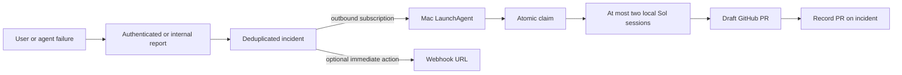

# Incident pipeline

Failures flow into the deployment's `incidents` table. `incidents:reportIncident` is internal; `reportClient` requires a signed-in owner, verifies project access and permits 20 reports per minute per owner. The server chooses deployment identity. Messages, stacks and allowlisted context fields are bounded and scrubbed; input values, media, prompts, headers and credentials must never be supplied. The fingerprint combines normalized message, code location and tool/task kind. Repeats update count, timestamps and four recent contexts. Resolving then reporting the same fingerprint opens a new generation.

Capture includes terminal chat cards, iframe preview errors, surfaced Convex mutation/action errors, upload/import/delete errors passed through `userError`, terminal media tasks and exports, assistant turn failures, Cloudflare runner failures and uncaught client exceptions. Save-confirmation observations settle on turn completion or a late tool observation, without a polling timer. The existing save evidence tables remain compatible with the older manual `incidents:fix` command; the new pipeline does not run it.

The shared editing toolkit exposes `reportIssue` on web, Cloudflare and MCP. Agents should report unexpected failures, wrong results and inconsistent contracts once, with tool name, a minimal input summary, observed behavior and expected behavior. Ordinary validation failures and unsupported requests do not qualify. This reports a defect without modifying the timeline.

Use Node 22+ and `npm run incidents:install` from this checkout. The installer generates separate 32-byte dev and prod secrets with OpenSSL, saves them in `~/.revline-incidents/config.json` with mode 0600, sets **only dev's** `INCIDENT_LISTENER_SECRET`, and installs `~/Library/LaunchAgents/com.revline.incidents.plist` with RunAtLoad and KeepAlive. It prints the exact command to set the production secret later and also saves that command in `~/.revline-incidents/enable-production.sh`. Reinstallation preserves the secrets. Both deployments are subscribed immediately; prod remains unavailable until its functions and secret are deployed. No public Mac endpoint, cron or polling loop is needed.

The listener claims before starting work, skips fingerprints with an open GitHub PR and prioritizes save/turn/export failures, then occurrence count and age. Local job records survive listener restarts; detached workers keep running and file events free capacity. Claims do not expire automatically: a lost process is marked failed instead of firing twice. Inspect failed jobs before explicitly calling `incidents:retry` with the secret, incident ID and generation. The same authenticated operations include `recordPR` and `resolve`; resolution requires the current count and generation so a newer occurrence cannot be silently cleared.

Each worker fetches `origin/main`, creates `~/Developer/revline-incident-<slug>`, writes `.data/incident-brief.md`, links only the dev environment and launches `codex exec --dangerously-bypass-approvals-and-sandbox -m gpt-6.1-sol -c model_reasoning_effort=xhigh`. The brief includes the full sanitized incident and related captured application events. It forbids production data and deployments, requires a real root cause, verification on disposable dev projects, a changelog entry, and a draft PR titled `Incident: ...`. `record-pr.ts` verifies the draft, branch and fingerprint through GitHub before recording the URL; the worker also recovers the PR on exit.

Logs and jobs are private under `~/.revline-incidents/`. Inspect `listener.log`, `listener-error.log`, the per-job worker log and `incident-*-sol.log`. `launchctl print gui/$(id -u)/com.revline.incidents` shows status. To stop automatic launch, run `launchctl bootout gui/$(id -u)/com.revline.incidents`; already detached Sol jobs keep running. A failed listener resumes on the next subscription or job event. Do not manually run a second listener while the LaunchAgent is active.

Optional real webhooks use deployment env `INCIDENT_WEBHOOK_URL`. A zero-delay Convex action POSTs the sanitized incident when a fingerprint opens or regresses, using `<incidentId>:<generation>` as its idempotency key. This is independent of the local claim. An HTTP failure appears in Convex action logs; it does not consume the local delivery. No periodic delivery attempts are scheduled.

Development deployments must preserve unmerged PR #23 (`origin/scene-3d`): deploy from a temporary merge until that PR is merged. Never use production credentials for dev verification.

After user merge approval, production rollout is manual:

1. Deploy the merged Convex code to **production different-gnu-398** with its own credentials (`npx convex deploy --env-file <production-env-file>`). Never substitute the dev backend.
2. From this configured Mac checkout, run the exact secret command printed by the installer, or `sh ~/.revline-incidents/enable-production.sh` with production CLI selection configured.
3. Deploy the production frontend and agent runner using the repository's existing release workflow so client capture and runner reporting reach the new functions.
4. Verify the prod subscription is authorized from local logs. Do not manufacture failures or use real production projects for this task's verification.
