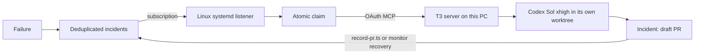

# Incident pipeline

Failures flow into the deployment's `incidents` table. `reportIncident` is internal; `reportClient` requires a signed-in owner, verifies project access and permits 20 reports per minute per owner. The server chooses deployment identity. Messages, stacks and allowlisted context are bounded and scrubbed; do not supply media, prompts, headers or credentials. Fingerprints combine normalized message, code location and tool/task kind. Repeats update count and four recent contexts. A recurrence after resolution opens a new generation.

Capture covers client errors, terminal media/export failures, assistant/runner failures and the shared editing toolkit's `reportIssue`. Agents should report unexpected failures and incorrect results once, with minimal diagnostic context. The listener classifies provider billing/402 errors, intended validation refusals (including “Add a clip before exporting”), and agent reports that explicitly find no defect before launching. It retains those diagnostics as failed deliveries with a reason and creates no T3 thread. An explicit retry runs the same classification again.



## Install on the PC

Use Node 22+, GitHub CLI signed in with repository access, and the existing T3 Code background service. Add the Revline repository as a T3 project and configure provider instance `codex`. Only the development `.env.local` belongs in this checkout; it must target `majestic-alpaca-541`.

Run `npm run incidents:install`. The installer:

- Signs the listener into this PC's `/mcp` endpoint using T3's [outside-agents OAuth flow](https://github.com/pingdotgg/t3code/blob/main/docs/user/outside-agents.md): dynamic registration, PKCE, scoped one-use pairing approval, and a code exchange. It uses the local `t3 auth pairing create` command for approval, never the thread CLI for launches.
- Grants the documented full-access MCP mode for unattended fixes. Its explicit scopes are `orchestration:read`, `orchestration:operate`, `settings:write`, and `source-control:write`; no general access-management credential is stored.
- Saves the OAuth credential in `~/.revline-incidents/t3-mcp.json`, the existing GitHub credential in `github-token`, and listener settings in `config.json` (files 0600, directory 0700). Tokens never appear in briefs or logs. T3 sign-ins expire after 30 days: rerun the installer and enable the service again to renew, or revoke the listener in T3's Sharing & access settings.
- Finds the T3 project by its shared Git repository, generates/preserves the dev listener secret, and sets only dev's `INCIDENT_LISTENER_SECRET`. A new installation subscribes only to dev; production credentials and configuration remain separate.
- Writes `~/.config/systemd/user/revline-incidents.service`, reloads systemd, and leaves the listener **stopped and disabled**. The optional macOS path only writes its LaunchAgent plist; it does not load it. Leave the existing Mac listener unloaded.

After review, enable the PC listener with:

```sh
systemctl --user enable --now revline-incidents.service
```

Linger is already enabled on this PC, so the enabled user service starts after reboot without a login. The unit starts after/wants `t3code.service`, restarts a failed listener and writes private logs under `~/.revline-incidents`. Linux uses a kernel-held abstract socket for a single listener per user; crashes leave no stale lock. The optional Mac implementation retains `shlock`.

T3's runtime file identifies the server on this machine. When T3 binds only its own VPN address, the client makes a temporary loopback HTTP forward to that local address. OAuth and MCP requests use localhost; no additional network-facing listener or T3 server restart is needed. MCP preserves the server's host header so saved thread links use its stable address. The forward closes with each MCP connection.

## Threads, claims and recovery

The listener checks GitHub before claiming, reuses existing fingerprint PRs, orders by priority and runs at most two incident jobs. It persists each claim before starting a detached monitor. Claims never expire automatically. Inspect failures before calling the authenticated `incidents:retry` operation; `recordPR` checks generation and claim token, and `resolve` also checks the occurrence count.

For each incident, the monitor fetches `origin/main`, then calls MCP `t3_thread_launch` with:

```json
{
  "modelSelection": {
    "instanceId": "codex",
    "model": "gpt-6.1-sol",
    "options": [{ "id": "reasoningEffort", "value": "xhigh" }]
  },
  "workspaceStrategy": {
    "type": "worktree",
    "baseRef": "origin/main",
    "startFromOrigin": true,
    "branch": "incident/<deployment-fingerprint-generation-claim>"
  }
}
```

The initial launch is idle so T3 can prepare and bind its own worktree first. The monitor reads that thread, links and validates only the dev environment, writes `.data/incident-brief.md`, then sends the brief through MCP. Stable claim-derived request IDs protect launch/send retries. Jobs persist the thread link, run ID and actual T3 worktree path. Threads appear in this PC's T3 sidebar and stay accessible from its linked Mac. T3 owns the Sol session; restarting the listener or losing a monitor does not start another Sol or release its concurrency slot. The listener reattaches a monitor to the saved thread.

The brief requires AGENTS.md, installed Next.js docs, typechecks/build, real runtime verification, a changelog entry and a draft `Incident:` PR. It forbids production data, credentials and deployment. `record-pr.ts` independently verifies the draft, branch and fingerprint on GitHub before writing back its URL. The monitor also recovers the draft when the T3 turn finishes. A turn without a matching PR is retained for inspection instead of being automatically repeated.

Use `systemctl --user status revline-incidents.service` and the private `listener.log`, `listener-error.log`, `incident-*.log`, and `jobs/*.json` files for delivery diagnostics; use the saved T3 link for Sol's activity. To stop automatic delivery:

```sh
systemctl --user disable --now revline-incidents.service
```

Already-started T3 sessions and detached monitors remain alive; stop an investigation explicitly in T3 when needed. For one scoped manual investigation while the service is stopped, run `npm run incidents:listen -- --incident <incident-id>`; other queued incidents remain pending.

## Development and rollout

Shared dev deployments must retain the latest main and other active dev integrations. If this pipeline is unmerged, include it when assembling the dev deployment; deploying a checkout without it removes the incident API. Preserve `.data/incident-dev-deploy` if one exists. Keep dev and production environment files and credentials separate.

Optional `INCIDENT_WEBHOOK_URL` delivery remains independent of local claims. A zero-delay action POSTs scrubbed new/regressed incidents with `<incidentId>:<generation>` as its idempotency key; there is no periodic delivery loop.

Production rollout requires the user's merge/deployment approval, its own backend credentials and a separately configured listener endpoint/secret. This installation and verification do not deploy, configure or subscribe to production.
