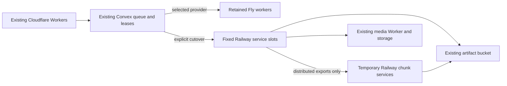

# Railway processor and export hosting

This change adds a reviewed path to move **only Fly processor/export containers and distributed export chunks** to Railway. Cloudflare frontend, media and agent Workers, Convex functions/database, Clerk, media storage and the existing distributed artifact bucket stay in place. Fly remains selected until an operator explicitly runs cutover. No migration command runs during install or build.

Implementation status: all three repository typechecks and the production build passed locally on 2026-11-04. Build used the CI public placeholder values and a local copy of the existing locked dependencies because Turbopack rejects the worktree's external dependency symlink. Credential-free planning, worktree apply rejection, non-Railway runtime rejection, syntax checks and an in-memory worker/control import bundle also passed. No Railway resources, credentials, deployment or real media/model jobs were used. The Docker daemon was unavailable; image builds and authenticated Railway runtime behavior still require authorized validation. This is not evidence of cloud parity. Production at the preparation baseline is `93b48dc978655507ea538a607f2fca6022743f35`.

## Runtime and limits



Each processor, standard export and Ultra export slot is a separate single-replica, image-backed service, with no repository autodeploy, public domain, volume or cron. The dispatcher only deploys stopped configured slots; it never creates permanent capacity. Existing `FLY_PROCESSOR_MAX_MACHINES` (default 4), `FLY_RENDER_MAX_STANDARD` and `FLY_RENDER_MAX_ULTRA` (default 10 each) remain capacity ceilings. A manifest exceeding a ceiling holds dispatch. Adjusting capacity is separate from migration; do not raise quotas or builders for this change.

Every service is created **without a source**, then given explicit `vCPUs: 4`, `memoryGB: 8` limits before its image is configured or deployed. Resource readback requires explicit overrides and merged CPU/byte limits no larger than 4 CPUs / 8192 MiB. The API's GB input may provide less than 8 GiB; it must never provide more. Entrypoint checks actual Linux cgroup v2 `cpu.max` and `memory.max` before runtime checks, model imports or queue connection. Missing/unlimited/oversized cgroups fail closed. It also validates Railway project/environment/service identity, the pinned image and queue slot membership. Thread settings stay at or below four; one task runs per slot.

Paid-plan ephemeral scratch must have at least 20 GiB free at startup. Files live in `/tmp/revline`; no Railway volumes or shared filesystems are used. Completed task directories and distributed plans/tars/chunks are removed. Interrupted checkpoint files survive only within that deployment; a cold replacement discards them. Storage pressure fails the task rather than increasing capacity automatically.

The worker runs the existing packaged FFmpeg, Chromium, fonts, renderer and, for processors, Python/model runtime check on every start. Export images omit processor Python/models. Preflight services run only this check, never connect to the queue, and are deleted in `finally`.

Railway serverless sleep uses network inactivity. Convex subscriptions send outbound traffic, so `sleepApplication` is false. Workers **exit after 60 idle seconds**, with restart policy `NEVER`. New demand triggers a fresh deployment of the digest. This is a cold redeploy, not Fly Machine resume; image pull, runtime checks and platform scheduling add latency. No warm-resume or throughput equivalence is promised.

## Environment mapping

| Setting | DEV | Production |
| --- | --- | --- |
| Convex deployment | `dev:majestic-alpaca-541` | `prod:different-gnu-398` |
| Convex URL | `https://majestic-alpaca-541.convex.cloud` | `https://different-gnu-398.convex.cloud` |
| Manifest | `.data/railway/dev.json` | `.data/railway/production.json` |
| Separate operator env file | primary `.env.local` | primary `.env.production.local` |
| Processor image | `ghcr.io/zurahq/revline-processor-dev@sha256:…` | `ghcr.io/zurahq/revline-processor@sha256:…` |
| Export image | `ghcr.io/zurahq/revline-exports-dev@sha256:…` | `ghcr.io/zurahq/revline-exports@sha256:…` |
| Service namespace | `revline-dev-*` | `revline-production-*` |
| Temporary namespace | `rv-t-dev-<timestamp>-*` | `rv-t-production-<timestamp>-*` |

Use separate Railway project/environment IDs, service IDs and project tokens for DEV and production. `RAILWAY_API_TOKEN` must be an environment-scoped project token, sent as `Project-Access-Token`; no account-token fallback exists. `projectToken` readback must match both manifest IDs. Never copy credentials from another machine/environment. The operator supplies existing credentials through the selected env file after approval.

Manifest shape (replace all angle-bracket placeholders; digests are 64 lowercase hex characters):

```json
{
  "environment": "dev",
  "projectId": "<DEV_RAILWAY_PROJECT_UUID>",
  "environmentId": "<DEV_RAILWAY_ENVIRONMENT_UUID>",
  "convexUrl": "https://majestic-alpaca-541.convex.cloud",
  "region": "us-east4-eqdc4a",
  "processorImage": "ghcr.io/zurahq/revline-processor-dev@sha256:<digest>",
  "exportsImage": "ghcr.io/zurahq/revline-exports-dev@sha256:<digest>",
  "processorServices": [],
  "standardServices": [],
  "ultraServices": [],
  "distributedExports": false
}
```

Empty arrays are valid for planning/building/provisioning. Provision writes created IDs back to this local manifest. For the first build, use valid locally recorded digest strings as placeholders; build replaces them with pushed GHCR digests before stage can verify them. For production change the environment, Convex URL, IDs, image repositories and file paths together. Duplicate service IDs or cross-environment image names are rejected. Keep manifests and their verification/rollback receipts in ignored `.data/`, outside Git.

| Source | Destination / purpose |
| --- | --- |
| Selected Convex `RENDER_WORKER_SECRET` | Processor `RENDER_WORKER_SECRET` |
| Selected Convex `MEDIA_WORKER_SECRET_EXPORTS` | Export `RENDER_WORKER_SECRET`; exports-only authorization remains enforced |
| Selected Convex `MEDIA_WORKER_URL` | Existing media Worker; media storage unchanged |
| Selected env file, otherwise same Convex deployment: `DEEPGRAM_API_KEY`, `FAL_KEY`, `GOOGLE_GENERATIVE_AI_API_KEY` | Processors only |
| Same selected sources: `GEMINI_VIDEO_MODEL`, `MEDIA_VISION_GEMINI_FALLBACK` | Optional processor settings |
| Selected env file `RAILWAY_API_TOKEN` | Convex dispatcher; distributed parent exports only when enabled |
| Manifest | Convex and services `RAILWAY_WORKERS_JSON` |
| Selected env file `AWS_ACCESS_KEY_ID`, `AWS_SECRET_ACCESS_KEY`, `AWS_ENDPOINT_URL_S3`, `BUCKET_NAME`, optional `AWS_REGION` | Existing distributed artifact bucket; export parents and chunks only |

Distributed manifests additionally require `artifactBucket` and `artifactEndpoint` exactly matching the selected env file. Preserve the existing `FLY_DISTRIBUTED_EXPORTS` boolean at initial staging. Migration does not enable distributed exports as a performance experiment or create/migrate a bucket. Chunks receive storage credentials and their plan/output keys, **no Convex worker secret, model key or Railway control token**.

DEV's `MEDIA_PROCESSOR_BACKEND=local` continues to use the local editor worker and existing shared loop. Only `cutover --kind processor` selects Railway processing. `--kind exports` leaves local processing alone. Agent worktrees retain `dev:isolated` and their scoped backends; these migration tools cannot mutate shared DEV from a worktree.

## Operator sequence after separate authorization

These commands are instructions for a later approved rollout, **not actions performed for this PR**. Queue-mutating commands require `--apply` and reviewed `main` in the primary checkout (or its exact main-push release runner). Without `--apply`, commands other than `status` only print the plan and make no API calls. `status` performs authenticated reads. `plan` needs no credentials. Do not run `release-main.mjs` merely to try this migration: it is the existing full release workflow.

The selected env file must contain its exact `CONVEX_DEPLOYMENT`, `NEXT_PUBLIC_CONVEX_URL`, Railway project token, and any required storage/model credentials. Convex CLI uses only the selected deployment; inherited deploy keys are removed unless explicitly supplied in that file. A supplied Convex deploy key must be scoped to that deployment. GHCR login/pull access and Docker Buildx must already be set up by the operator; tooling never changes registry account permissions. If images are private, registry credentials must be configured separately before preflight. Do not alter quotas/builders to get a green check.

Start with DEV and choose only the role being migrated. For example, exports with two standard and two Ultra slots (counts are explicit examples, never exceed the existing deployment ceilings):

```sh
node scripts/railway-workers.mjs plan --environment dev --config .data/railway/dev.json --kind exports
node scripts/railway-workers.mjs build --environment dev --config .data/railway/dev.json --kind exports --apply
node scripts/railway-workers.mjs provision --environment dev --config .data/railway/dev.json --env-file .env.local --kind exports --standard 2 --ultra 2 --apply
node scripts/railway-workers.mjs stage --environment dev --config .data/railway/dev.json --env-file .env.local --kind exports --apply
node scripts/railway-workers.mjs status --environment dev --config .data/railway/dev.json --env-file .env.local --kind exports
node scripts/railway-workers.mjs cutover --environment dev --config .data/railway/dev.json --env-file .env.local --kind exports --apply
```

Deploy the reviewed Convex control functions through the normal separately authorized release before `provision`/`stage`; this PR itself does not deploy them. Build pushes `linux/amd64` images from the existing credential-free allow-list context, with explicit `railway-processor` / `railway-exports` targets. The pinned beat-model cache must already be available for a processor image; tooling does not install dependencies into other worktrees. The default Docker target and Fly targets remain unchanged.

To migrate processors, use `--kind processor` throughout and `provision --processors <count>`; to migrate both, use `--kind all` and all three counts. Use the production manifest, `--environment production` and `.env.production.local` for the separately approved production rollout. Nothing infers a production target from DEV.

`stage` runtime-preflights the images in bounded temporary services; then sets the global Railway pause, waits for selected Railway slots to exit, configures stopped slots, records the token/manifest in Convex, and boots one consumer per selected lane while claims are forbidden. It requires authenticated queue/readiness logs followed by idle exit, writes `<manifest>.verified.json`, and restores the prior pause. It does not change either provider selector. On failure after the pause, it deliberately leaves the hold in place; inspect the error and rerun stage before resuming.

`verify --apply` can rerun isolated runtime preflights and slot drift checks, but does not create the staging receipt. Cutover requires the exact staged manifest/token, matching source/Convex processor contract, configured slots, resource checks and an unpaused queue. It first exclusively writes `<manifest>.rollback.json`, then switches only the requested `MEDIA_PROCESSOR_BACKEND` and/or `RENDER_PROVIDER` and dispatches. A partial switch can always use that saved rollback. Archive a used rollback file only after its rollout is resolved, before beginning a new cutover.

Later main releases select the host independently for each role/deployment. Already migrated Railway processors build and stage before the matching Convex contract; exports stage after it. `--image-first` is reserved for that processor stage. Unmigrated roles retain the existing Fly release path, including DEV local-backend preservation. The release pipeline never runs initial provisioning or cutover.

## Leases, drain, cancellation and failure recovery

The existing Convex queue remains authoritative. `ready` and the transactional `claim` both filter by selected processor/export provider, so pre-staged Railway consumers cannot take Fly work and old Fly consumers stop taking new work after cutover. Existing claimed tasks continue on their original worker. Owner render seats, queued export limits, Standard/Ultra lanes, version requirements, fairness and retry policy are retained. The shared loop renews 60-second leases every 20 seconds and polls cancellation every few seconds. Lost leases stop work; interrupted attempts recover through the existing scheduled retries, with at most three attempts. Render deadlines stay 45 minutes.

The dispatcher uses the existing lock table with separate Railway keys, a two-minute start reservation for lost acknowledgements, and a one-minute recovery cron. Unknown deployment states retain capacity. Railway API/schema/permission failures retain queued work. Calls are paced within each process; HTTP 429 puts Convex dispatch on a durable cooldown using `Retry-After`/reset headers. A CLI command fails visibly on rate limiting; wait the provider's retry window before rerunning. Mutations are not blindly retried. Platform singleton semantics plus queue leases provide recovery, not an exactly-once execution guarantee.

`pause` sets `RAILWAY_WORKERS_PAUSED=true`: both dispatch and new Railway claims stop; active tasks retain heartbeats and finish. It waits up to 50 minutes for the selected slots, then fails visibly if any remain. Use `--kind all` to await every pool. The authenticated `/drain` endpoint and Railway SIGTERM similarly stop new claims. Railway settings request 3000 seconds of deployment drain, but platform termination/host loss can still bypass graceful completion; leases recover interrupted work. Do not redeploy a busy worker to force progress. No public endpoint is provisioned for drain.

```sh
node scripts/railway-workers.mjs pause --environment dev --config .data/railway/dev.json --env-file .env.local --kind all --apply
node scripts/railway-workers.mjs resume --environment dev --config .data/railway/dev.json --env-file .env.local --kind all --apply
node scripts/railway-workers.mjs rollback --environment dev --config .data/railway/dev.json --env-file .env.local --apply
```

Resume requires the exact staged manifest/token. Rollback sets the Railway pause, restores only the selectors recorded before cutover and wakes the prior Fly dispatcher where applicable; it does not require a successful Railway API call. A previously migrated, unaffected Railway role is resumed after restoring routes. Running Railway tasks finish on their existing leases. Fly images, app secrets, resources and storage are retained. Rollback does not recreate missing/deleted Fly infrastructure or deploy old code; verify the retained Fly images remain compatible before authorizing cutover. No command here deletes Fly resources.

Distributed parents render one local chunk and create at most 15 remote chunk services (16 total), each capped at 4 CPUs/8192 MiB. Launches are sequential control operations to limit API bursts; rendering is concurrent. The existing plan/chunk storage protocol and assembler stay unchanged. Each attempt has a unique `exports/<taskId>/<uuid>` prefix, avoiding reuse of a cancelled attempt's artifacts. Object existence signals completion; lifecycle is checked at most every five minutes per remote chunk. A chunk that exits without output gets one retry. A remote chunk process has a 35-minute hard timeout; parents wait at most 40 minutes for remote output, within their 45-minute task deadline.

Normal completion, failure and cancellation delete launched chunk services and attempt objects in `finally`. Hard termination or a lost create acknowledgement can bypass cleanup. The Convex cron and `reap` sweep only this environment's timestamped `rv-t-*` chunk/preflight services older than 55 minutes, including interrupted creates; permanent slots are excluded. Service enumeration is paginated. Cleanup failures are logged and retried by that sweep. If the Railway token is revoked, restore its environment-scoped access before reaping.

Object storage has no automatic lifecycle change in this migration. Hard-killed parent attempts can leave private artifact objects; recover the exact prefix from `artifact-prefix` / `artifact-cleanup-pending` logs, pause all slots, and run:

```sh
node scripts/railway-workers.mjs reap --environment dev --config .data/railway/dev.json --env-file .env.local --apply
node scripts/railway-workers.mjs reap-artifacts --environment dev --config .data/railway/dev.json --env-file .env.local --artifact-prefix 'exports/<taskId>/<uuid>' --apply
```

Artifact recovery requires the paused queue, stopped parent slots, matching existing bucket/endpoint and verified object ages of at least 55 minutes. It removes only `plan.tar` and chunk 0–15 under that exact Railway attempt prefix, never Fly's shorter prefix. It is repeatable after partial failure. Automatic orphan-object expiration would require a separately approved bucket policy; it is not claimed here.

## Verification gates and official references

Repository checks: `npm run typecheck`, `npm run typecheck:agent-runner`, `npm run typecheck:processor-edge`, `npm run build`, `git diff --check`, syntax inspection and direct execution of credential-free planning/runtime guards. No test files, fixtures, mocks or live jobs are added.

Before an authorized cutover, run the real image build, `stage` and `status` for the exact environment. Confirm the Railway scalar limit readback, cgroup v2 visibility, single-region/single-replica placement, successful idle exit, GHCR pull permissions, queue authentication, scratch headroom and eventual deployment-state reads. These cannot be proven by TypeScript or public schema introspection. Then separately authorize representative media/export validation, including cancellation, worker loss, distributed assembly and rollback; none were executed for this draft. Pro-plan API capacity may be needed at larger existing pool sizes; fail/hold on limits rather than automatically changing the account plan.

Official documentation checked 2026-11-04:

- [Public API](https://docs.railway.com/integrations/api): environment-scoped project-token headers, introspection, GraphQL errors and rate limits. The public endpoint was queried **only for schema metadata without credentials**. Used mutation/input/field names were present and non-deprecated; the JSON resource-limit scalar's actual response still needs authenticated verification.
- [Manage services](https://docs.railway.com/integrations/api/manage-services): empty services, instance settings, resource queries and `serviceInstanceDeployV2` returning a deployment ID.
- [Manage deployments](https://docs.railway.com/integrations/api/manage-deployments): deployment logs/status and stop/redeploy operations. Public `DeploymentStatus` has no Fly-style `stopped` state; `deploymentStopped` is read separately.
- [Railway configuration JSON schema](https://railway.com/railway.schema.json): CPU/byte resource shape, regional replica configuration and drain/overlap settings. The readback parser's CPU/byte interpretation is an inference from this schema; a different scalar response fails closed.
- [Restart policy](https://docs.railway.com/deployments/restart-policy), [serverless](https://docs.railway.com/deployments/serverless) and [deployment teardown](https://docs.railway.com/deployments/deployment-teardown): explicit exit/redeploy lifecycle and SIGTERM limitations.
- [Deployment reference](https://docs.railway.com/deployments/reference), [volume reference](https://docs.railway.com/volumes/reference) and [scaling](https://docs.railway.com/deployments/scaling): paid ephemeral storage, volume/replica restrictions and per-replica resources.
- [Regions](https://docs.railway.com/deployments/regions): accepted region identifiers.

## Pre-merge Railway-only staging

`build` and `preflight` accept a clean checkout at the exact published open PR #82 head, checked through GitHub. All other apply commands retain the primary-main gate. Use the existing production project `759ce3c9-db81-4ade-ae3b-2c21070f7442` and environment `b81548ce-f856-433b-a3aa-80f51d06ddd8`; do not create replacements.

Run `preflight --environment production --config .data/railway/production.json --env-file .data/railway/production.env --kind all --apply` after building pinned images. The separate env file must declare the exact production Convex selector and URL plus the Railway environment-scoped project token. This command never invokes Convex, reads backend credentials, connects a queue, writes a cutover receipt or changes routing. It creates one temporary service at a time, enforces existing CPU/memory limits, validates the real runtime and deletes each service in `finally`. A successful preflight does not authorize cutover: full authenticated queue staging and its receipt still require the deployed matching contract through the normal main release.

## Mac CLI access

Railway CLI 5.71.0 was installed with `brew install railway` and authenticated using `railway login --browserless`, authorizing the displayed activation link in the already signed-in browser. `railway whoami` confirmed the existing account. Login persists in Railway's private CLI configuration; no account API key or browser cookie extraction is used.

Before operating, run:

```sh
railway whoami
railway link --project 759ce3c9-db81-4ade-ae3b-2c21070f7442 --environment b81548ce-f856-433b-a3aa-80f51d06ddd8
railway status --json
node scripts/railway-workers.mjs build --environment production --config .data/railway/production.json --kind all --apply
node scripts/railway-workers.mjs preflight --environment production --config .data/railway/production.json --env-file .data/railway/production.env --kind all --apply
```

Check both UUIDs in CLI status. The deployment commands independently verify the environment-scoped project token against both manifest IDs. The private operator env file is ignored by Git and mode 0600. CLI login alone does not bypass queue-stage/cutover gates. After migration, use the existing main release for image updates, draining and contract ordering; avoid bare `railway up` or redeploying an active consumer.

Authenticated resource check: temporary service `28cb2f32-6b97-4fd2-b684-4317dc2dc12f` accepted 4 CPUs / 8 GB and returned nested `containers` limits of 4 CPUs / 8,000,000,000 bytes. The empty service was deleted afterward. Temporary names use `rv-t-p-<timestamp>-<suffix>` for production and `rv-t-d-<timestamp>-<suffix>` for DEV.
