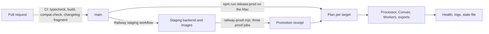
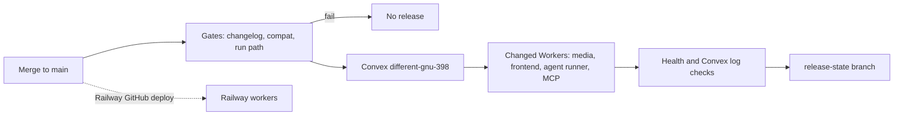

# Releases

How merged work reaches production: what a pull request must pass, the one release command, rollback, Railway and the incident listener.



## Merging

- One pull request per change, reviewed as a draft and merged by the founder. Agents never push to or merge into `main`.
- **Changelog:** each pull request adds one file, `docs/changelog.d/<YYYY-MM-DD>-<slug>.md`, with `- <System>: <what changed>. Why: <reason>.` (at most two lines per entry). Nobody edits `docs/changelog.md` in a pull request, so entries never conflict. The release command assembles the fragments (`node scripts/changelog.mjs build`).
  `merge=union` in `.gitattributes` was tried first: it merges locally, but GitHub still reports the pull request as conflicting (checked on 2026-11-10 with the attribute on both branches).
- A pull request that is behind `main` no longer needs a "keep both sides" changelog resolution; update the branch only when GitHub reports a real conflict.

## What CI checks on every pull request

The `Release gates` workflow (`.github/workflows/release-gates.yml`, GitHub-hosted runner, read-only token) runs on every pull request. It is separate from `Validate` (typecheck and build), which is currently disabled in the repository's Actions settings, so the gates run either way:

| Gate | Fails when | Fix |
| --- | --- | --- |
| iOS contract | A public Convex function called from `mobile/` (the `"module:function"` strings, read at check time from both revisions) removes, renames or retypes an argument or return field, adds a required argument, or changes its return container | Keep the function and add a new name for the new shape (`projects:listPage`) |
| Processor capability | `referenceReadMode` or `mediaTaskKind` gains a member that is not in `GATED_READ_MODES` / `GATED_TASK_KINDS` in `lib/server/processor-capabilities.ts`, or no Convex caller checks `processorCan(ctx, '<id>')` | List it as gated and make the caller degrade when `processorCan` is false |
| Schema | `convex/schema.ts` removes a table, index or field, changes an index or a field type, or adds a required field to an existing table | Make it additive: new optional field, new index name, widened union |
| Changelog | `docs/changelog.md` is edited, or a fragment is misnamed or malformed | Add a fragment file instead |

New optional arguments, added return fields, new tables, new indexes and new optional fields pass.

An intended break needs one line in `mobile/CONTRACT_CHANGES.md`, added in the same pull request, naming the item exactly as the check prints it and why it is safe. Only a line added in that range counts.

Run it locally: `npm run compat:check` (HEAD against the merge-base with `origin/main`), `-- --head WORKTREE` for uncommitted work, `-- --base <rev> --head <rev>` for any range.

### Processor capabilities

Convex and the media processor are released separately, so new Convex code can meet an older processor, which answers an unknown read mode with an empty success. Processors now report their capability list when they start their queue loop (`mediaProcessor:reportCapabilities`, next to the contract number, retried until the backend has the function), and Convex stores the last report per backend. `processorCan(ctx, '<id>')` is true for a gated capability only when the processor reported it, and false when no processor has ever reported; a new gated capability therefore stays off until the processor image that has it is promoted and signs in.

The looks read is the one caller that passes `{ whenUnreported: true }`: a processor image from before reporting may already measure faces, so the read is queued and its "no samples means unmeasured" check decides, as it did before. That check also remains the fallback for a stale report (a mixed rollout, an image rollback).

## Releasing production

Every merge to `main` now releases Convex and the Cloudflare Workers automatically (below, "Automatic release on merge"). The Mac command stays the fallback, and it is still how Railway and the incident listener are released by hand.

On the Mac that holds the production credentials, in a primary checkout (not a worktree) of `main` at `origin/main`:

```sh
npm run release:prod -- --dry-run   # the plan, from any machine, nothing deployed
npm run release:prod
npm run release:status              # what is on production
```

`release:prod` refuses to run unless it is on macOS, `.env.production.local` (or `REVLINE_PRODUCTION_ENV_FILE`) targets `prod:different-gnu-398`, the checkout is clean on `main` and `HEAD` equals `origin/main`. It holds `.data/production-releases/release.lock` while it runs. It never touches the development deployment.

What it does, in order, each target only when its inputs changed since that target's recorded commit (`scripts/release-plan.mjs`):

1. **Pre-flight:** the compat check for `<oldest deployed commit>..HEAD`, typechecks, and the only frontend build (`npm run build:cloudflare`).
2. **Railway processor image** first, when production routes processing to Railway (see Railway below).
3. **Convex:** `convex deploy`, which returns only after new indexes are backfilled and the schema is validated, then the processor contract is read back.
4. **Media Worker**, **frontend**, **agent runner** (settings synced from Convex first), **MCP Worker**: the serving version is recorded, the Worker is deployed and checked to serve 100% of traffic; the frontend's live build ID is checked.
5. **Railway export workers.**
6. **Post-deploy verification:** frontend origins, agent runner `/health`, the media Worker refusing an unsigned request, MCP OAuth discovery, and a 30-second read of production Convex logs for argument-validation errors, missing functions, worker authentication failures and unknown modes. Only a failure on a function that did not show it before the first deploy of the run counts.
7. **Incident listener** (below), then the **changelog**, only when every target was released: fragments are assembled, committed and pushed to `main` with `[skip ci]`. If the push is refused the fragments are kept for the next release.

It ends with one table: target, old → new commit, result. Each released target is written to `.data/production-releases/deployed.json` as it succeeds, so a failed run is continued by running the command again.

Flags: `--only <target,…>`, `--base <commit>` (comparison commit when nothing is recorded), `--auto-rollback`, `--founder-bypass "<reason>"`, `--no-changelog`. Targets: `processor`, `convex`, `media`, `frontend`, `agent`, `mcp`, `exports`, `incident-listener`.

**First run on the Mac:** record what production runs now, once: `npm run release:status -- --set all=<commit on production>`. Without it every target counts as changed and the compat check is skipped.

The older `deploy-main.yml` workflow (self-hosted PC runner) is unchanged and still refuses to run while the release lock exists. Keep it disabled: `Release production` replaces it, and both run on every push to `main`.

## Rollback

When a verification fails, `release:prod` prints the exact rollback commands for what that run deployed and exits non-zero. It rolls nothing back by itself.

- **Workers:** `npx wrangler rollback <previous-version-id> --config <config>`. `--auto-rollback` runs these and corrects the state file, for the Worker whose own check failed, or for every Worker of the run when the post-deploy verification failed. A later unrelated failure leaves healthy Workers serving.
- **Convex:** manual, a redeploy of the previous commit from a detached worktree (commands printed). Once slots run images, a Convex commit from before `imageSlots` holds Railway dispatch (its dispatcher accepts only repository slots): roll Convex back no further than this change, or restage the slots from the repository first. Schema and data written since are not undone, which is why the schema gate only lets additive changes through.
- **Railway:** a `stage` that fails after pausing claims restores the previous images and resumes claims by itself (below). To undo a stage that succeeded: promote the previous release again through staging.

## Railway

Production Railway is staged only with a staging promotion receipt: proof that a processing task, a standard export and an Ultra export completed on staging on the exact commit and image digests. That requirement is unchanged. What changed is who runs the jobs.

`node scripts/railway-proof.mjs --commit <main sha>` takes the staging manifest of that commit (artifact of its `Railway staging` workflow run), starts the three jobs on staging, waits, finds the Railway deployment that completed each, writes `.data/railway/promotion.json` and verifies it the way production will. `release:prod` calls it when the setup exists and otherwise reports `Railway not promoted: run the one-time staging setup` and continues with the other targets; run it again on the same commit once the setup exists. A staging error that is not a missing setup stops the release. If the range raises the processor contract (`lib/media-analysis/processor-version.ts`) and the production processor is not at the release commit, for any reason, Convex and everything after it are held.

The commit's `Railway staging` run must be green first; it starts on every push to `main`. The image builds hit the GitHub Actions layer cache (seconds when the Dockerfile layers are unchanged); the run used to spend 11 to 17 minutes rebuilding each slot from the repository on Railway, which image slots remove. A push that lands while another run is going waits for it (`concurrency`, not cancelled, so staging is never left paused).

### Production runs the digest staging proved

The `Railway staging` workflow builds `ghcr.io/revlinehq/revline-railway-processor@sha256:…` and `…-exports@sha256:…`, points the staging slots at those digests (Railway service source = Docker image, no Railway build) and the proof runs its jobs on them. Production `stage` points the production slots at the same digests, taken from the receipt: nothing is built from the repository.

Slots switch per environment with `serviceInstanceUpdate(serviceId, environmentId, input: { source: { image }, registryCredentials: { username, password } })` (never `serviceConnect`, which changes the service in every environment). A slot that still reports its repository afterwards fails the slot check and is restored. Proof evidence for an image deployment is the image itself plus the runtime log: `railway-runtime-verified` reports the commit baked into the image (the runtime refuses to start on any other) and the digest.

Image slots need two things; until both exist, `stage` keeps building the commit from the repository (slow path) and says why:

1. **Production Convex reports image slots** (`railwayWorkers:contract` returns `imageSlots: true`). The dispatcher that starts slots lives in Convex, and an older one holds dispatch for an image slot. The first release of this change therefore stages the processor from the repository one last time, then deploys Convex; exports, staged after Convex, already switch.
2. **Registry credentials** in the Railway production env file (`.data/railway/production.env`, or `.env.production.local` when that file does not exist), mode 600:
   ```
   RAILWAY_REGISTRY_USERNAME=<GitHub user that owns the token>
   RAILWAY_REGISTRY_PASSWORD=<classic GitHub token, read:packages only>
   ```
   The GHCR packages are private (an anonymous pull gets 403). Use a classic personal access token with only `read:packages`, from an account that can read the `revlinehq` packages (and `zurahq`, for digests pinned before the transfer). Railway stores it on each slot as the private registry credential. Staging uses the repository secret `RAILWAY_STAGING_REGISTRY_PASSWORD` (username from the repository variable `RAILWAY_STAGING_REGISTRY_USERNAME`, default `zuraHQ`).

### Order of a production `stage` and automatic restore

1. **Checks, while production still runs and claims:** the project token, every slot variable (`RENDER_WORKER_SECRET`, `MEDIA_WORKER_SECRET_EXPORTS`, `MEDIA_WORKER_URL`, `DEEPGRAM_API_KEY`, `FAL_KEY`, `GOOGLE_GENERATIVE_AI_API_KEY`, …), every slot readable and in the Revline namespace, and a GHCR pull check of the staged digests and of the previous release's digests with the registry credentials. `release:prod` also runs these (`railway-workers.mjs check`, read-only) in its pre-flight, before the staging proof.
2. **Runtime check of each staged image on a temporary service** (no slot touched).
3. Pause claims, drain, point the slots at the digests, set the manifest, verify each lane's queue connection with claims paused, resume claims.

Any failure in step 3 restores every slot to the manifest that ran before (its previous image, or its previous repository build redeployed without a rebuild), restores the manifest and token in Convex and resumes claims. If the restore itself fails, claims stay paused and the output says so. A stage with no previous manifest on the deployment cannot restore and says so before pausing.

### Retrying a release

A retry of the same commit reuses the proof receipt instead of rerunning the jobs: it prints `reusing proof receipt <id>` when `.data/railway/promotion.json` proved the same commit and the same image digests (the newest successful staging build of that commit), is less than 24 hours old, and still passes the full live check production runs. A different commit or digest, an older receipt, or a receipt that no longer verifies reruns the proof. `node scripts/railway-proof.mjs --commit <sha> --fresh` forces a new one.

### The staging service identity

The jobs run as `service_railway-proof` (`convex/stagingProof.ts`). This is not acting as a user: the owner is a fixed string no Clerk subject (always `user_…`) can equal, made only of the characters media storage keys allow, it is hard-coded and never an argument, no proof function accepts an `ownerId` or `subject`, it owns only its own fixture project (a two-second solid-colour timeline with no uploaded media), and every function refuses to run outside the isolated staging deployment. It reaches no user data and goes around no MCP owner or task check. The rule in `AGENTS.md` about not acting as a user stands.

### One-time setup (founder, on the Mac)

1. Merge the pull request that adds `convex/stagingProof.ts`. The `Railway staging` workflow deploys Convex to staging on the next push to `main`.
2. Create `.data/railway/staging.env` (ignored, mode 600) in the release checkout:
   ```
   CONVEX_DEPLOYMENT=prod:striped-starling-234
   NEXT_PUBLIC_CONVEX_URL=https://striped-starling-234.convex.cloud
   CONVEX_DEPLOY_KEY=<staging deploy key>
   RAILWAY_API_TOKEN=<staging environment project token>
   RENDER_WORKER_SECRET=<staging processor secret>
   ```
   The first two secrets are the values behind the repository secrets `RAILWAY_STAGING_CONVEX_DEPLOY_KEY` and `RAILWAY_STAGING_API_TOKEN`.
3. Staging must route work to Railway and not be paused: `MEDIA_PROCESSOR_BACKEND=railway`, `RENDER_PROVIDER=railway`, `RAILWAY_WORKERS_PAUSED` not `true`.
4. `gh` signed in on the Mac with Actions read access (it downloads the staging manifest artifact).
5. `node scripts/railway-proof.mjs --check` must exit 0. The fixture project and its staging entitlement are created by the first proof run.

Receipts are reused for 24 hours (above) and stop verifying after about 7 days, when finished media tasks are pruned.

### Founder bypass

`npm run release:prod -- --founder-bypass "<reason>"`, or `node scripts/railway-workers.mjs stage --environment production … --founder-bypass "<reason>" --apply`, skips the receipt for that one production `stage` run. Before anything changes it appends who, when and why to `.data/railway/founder-bypass.log`; if the log cannot be written the run stops. It still promotes only the image digest the `Railway staging` workflow built for that commit, and it does not apply to `resume` or `cutover`. Use it only on the founder's explicit word.

Manual operator commands and environment boundaries: `docs/railway-worker-migration.md`.

## Incident listener

The production issue publisher runs on the Mac as the LaunchAgent `com.revline.incident-issues-prod` from its own checkout. When that plist exists, `release:prod` fast-forwards its checkout to the release commit (only when it is clean on `main`), runs `npm ci` when the lockfile changed, restarts it with `launchctl kickstart -k` and confirms it is running. Without the plist the step is skipped. Background: `docs/incidents.md`.

## After a release

Development checkouts are not part of the release: pull the Mac dev checkout and restart its dev server after merges as before.

## Automatic release on merge

`.github/workflows/release-production.yml` (`Release production`) runs `release:prod` on a GitHub-hosted runner for every push to `main`. It is the same command in CI mode (`REVLINE_RELEASE_CI=1`), not a second release path.



- **Gates first.** The `gates` job runs the changelog check, `compat-check.mjs` on the pushed range and `run-path-check.mjs`. If one fails, the release job is skipped. `release:prod` then runs the compat check again, from the oldest commit still deployed, and the typechecks, before it deploys anything.
- **What it releases.** Convex first, then only the Workers whose inputs changed (media, frontend, agent runner, MCP), then the post-deploy checks. It never touches Railway or the incident listener. Railway deploys its workers itself from GitHub. The incident listener is updated by the next release from the Mac.
- **One at a time.** Releases share the concurrency group `revline-production-release`. A running release is never cancelled. A newer push replaces a release that is still waiting, and the newer release includes the older commits, because each target is compared with its own deployed commit. A run whose commit is behind `main` still releases, unless production already runs something newer. That happens on a re-run of an old run, which then exits without deploying. A dispatched dry run gets its own group.
- **On failure** the run stops and fails, prints the rollback commands, and comments on the commit. Nothing is rolled back automatically (no `--auto-rollback`).
- **Raised processor contract.** A range that changes `lib/media-analysis/processor-version.ts` holds Convex until the processor is recorded at the release commit. Once Railway runs it, record it with `npm run release:status -- --set processor=<sha> --push` and re-run the workflow.
- **Retry** with "Run workflow" on `main` and `dry_run` unticked.
- **Production only.** The workflow writes a Convex env file outside the checkout, and only accepts a deploy key that starts with `prod:different-gnu-398|`. The Convex CLI calls (`env list`, `logs`, the agent settings sync) refuse any other key. Builds never receive the key.

### Shared release state

The deployed commit of each target lives in `deployed.json` on the `release-state` branch of origin. `release:prod` reads it before planning, on the Mac and in the workflow, and merges it with the local `.data/production-releases/deployed.json`. For each target the newer record wins. After deploying, it publishes the result, including after a failure. A stale record is safe: the next plan only compares against an older commit and releases more. `npm run release:status -- --pull` and `-- --push` sync it by hand.

### Manual fallback

`npm run release:prod` on the Mac works as before. It now also reads and publishes the shared state, so the workflow does not release the same targets again. If origin cannot be read, it warns and plans from its local file. It refuses while a `Release production` run is in progress (it asks `gh`; without `gh` it warns, so check by hand). The Mac's lock file does not stop the workflow.

### One-time setup (founder)

1. **Seed the shared state.** On the Mac, in the release checkout: `npm run release:status -- --push`. Until this is done, the workflow refuses to deploy and says why. The alternative is to run the workflow by hand with `base` set to the commit production runs.
2. **GitHub environment `production`** (Settings → Environments): under deployment branches, allow only `main`. Add:

   | Kind | Name | Where it comes from |
   | --- | --- | --- |
   | Secret | `CONVEX_DEPLOY_KEY` | Convex dashboard → project → production deployment `different-gnu-398` → Settings → Generate production deploy key. It starts with `prod:different-gnu-398\|`. |
   | Secret | `CLOUDFLARE_API_TOKEN` | Cloudflare → My Profile → API Tokens → "Edit Cloudflare Workers" template, limited to the Revline account (`701645e9…`) and the `tryrevline.com` zone. Add Zone → DNS: Edit if the first deploy reports a custom-domain permission error. |
   | Variable | `NEXT_PUBLIC_SENTRY_DSN`, `NEXT_PUBLIC_POSTHOG_KEY`, `NEXT_PUBLIC_POSTHOG_HOST`, `NEXT_PUBLIC_TELEMETRY_ENABLED`, `NEXT_PUBLIC_MCP_ORIGIN` | The same values as the Mac's `.env.production.local`. Leave out any that the file does not set. The other public settings are committed in `wrangler.jsonc`. |

   No account ID is needed: every Worker config pins `account_id`.
3. **Avoid double deploys.** In Cloudflare → Workers & Pages, open `revline-web`, `revline-agent-runner-production`, `revline-editor-media-production` and `revline-mcp-production`. Under Settings → Build, disconnect any connected Git repository (Workers Builds). `revline-web` was connected once, to `codex/mvp`. Keep `deploy-main.yml` disabled.
4. **Check.** Run the workflow by hand with `dry_run` ticked. It prints the plan and uses no credentials. Then let the next merge release.
