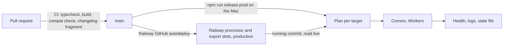
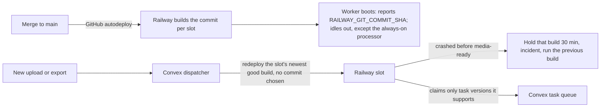
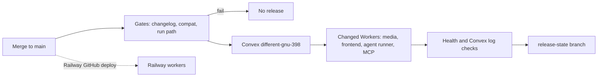

# Releases

How merged work reaches production: what a pull request must pass, the one release command, rollback, Railway and the incident listener.



## Merging

- One pull request per change, reviewed as a draft and merged by the founder. Agents never push to or merge into `main`.
- **Changelog:** each pull request adds one file, `docs/changelog.d/<YYYY-MM-DD>-<slug>.md`, with `- <System>: <what changed>. Why: <reason>.` (at most two lines per entry). Nobody edits `docs/changelog.md` in a pull request, so entries never conflict. The release command assembles the fragments (`node scripts/changelog.mjs build`).
  `merge=union` in `.gitattributes` was tried first: it merges locally, but GitHub still reports the pull request as conflicting (checked on 2026-11-10 with the attribute on both branches).
- A pull request that is behind `main` no longer needs a "keep both sides" changelog resolution; update the branch only when GitHub reports a real conflict.

## What CI checks on every pull request

The `Release gates` workflow (`.github/workflows/release-gates.yml`, GitHub-hosted runner, read-only token) runs on every pull request. It is separate from `Validate` (typecheck and build), which is currently disabled in the repository's Actions settings, so the gates run either way:

| Gate | Fails when | Fix |
| --- | --- | --- |
| iOS contract | A public Convex function called from `mobile/` (the `"module:function"` strings, read at check time from both revisions) removes, renames or retypes an argument or return field, adds a required argument, or changes its return container | Keep the function and add a new name for the new shape (`projects:listPage`) |
| Processor capability | `referenceReadMode` or `mediaTaskKind` gains a member that is not in `GATED_READ_MODES` / `GATED_TASK_KINDS` in `lib/server/processor-capabilities.ts`, or no Convex caller checks `processorCan(ctx, '<id>')` | List it as gated and make the caller degrade when `processorCan` is false |
| Schema | `convex/schema.ts` removes a table, index or field, changes an index or a field type, or adds a required field to an existing table | Make it additive: new optional field, new index name, widened union |
| Changelog | `docs/changelog.md` is edited, or a fragment is misnamed or malformed | Add a fragment file instead |

New optional arguments, added return fields, new tables, new indexes and new optional fields pass.

An intended break needs one line in `mobile/CONTRACT_CHANGES.md`, added in the same pull request, naming the item exactly as the check prints it and why it is safe. Only a line added in that range counts.

Run it locally: `npm run compat:check` (HEAD against the merge-base with `origin/main`), `-- --head WORKTREE` for uncommitted work, `-- --base <rev> --head <rev>` for any range.

### Processor capabilities

Convex and the media processor are released separately, so new Convex code can meet an older processor, which answers an unknown read mode with an empty success. Processors now report their capability list when they start their queue loop (`mediaProcessor:reportCapabilities`, next to the contract number, retried until the backend has the function), and Convex stores the last report per backend. `processorCan(ctx, '<id>')` is true for a gated capability only when the processor reported it, and false when no processor has ever reported; a new gated capability therefore stays off until the processor image that has it is promoted and signs in.

The looks read is the one caller that passes `{ whenUnreported: true }`: a processor image from before reporting may already measure faces, so the read is queued and its "no samples means unmeasured" check decides, as it did before. That check also remains the fallback for a stale report (a mixed rollout, an image rollback).

## Releasing production

Every merge to `main` now releases Convex and the Cloudflare Workers automatically (below, "Automatic release on merge"). The Mac command stays the fallback, and it is still how the incident listener is updated.

On the Mac that holds the production credentials, in a primary checkout (not a worktree) of `main` at `origin/main`:

```sh
npm run release:prod -- --dry-run   # the plan, from any machine, nothing deployed
npm run release:prod
npm run release:status              # what is on production
```

`release:prod` refuses to run unless it is on macOS, `.env.production.local` (or `REVLINE_PRODUCTION_ENV_FILE`) targets `prod:different-gnu-398`, the checkout is clean on `main` and `HEAD` equals `origin/main`. It holds `.data/production-releases/release.lock` while it runs. It never touches the development deployment.

What it does, in order, each target only when its inputs changed since that target's recorded commit (`scripts/release-plan.mjs`):

1. **Pre-flight:** the compat check for `<oldest deployed commit>..HEAD`, typechecks, and the only frontend build (`npm run build:cloudflare`).
2. **Railway processor**, when production routes processing to Railway: Railway deploys it from `main` by itself; the release reads the commit each slot runs and records it. If the range raises the processor contract and the processor does not run this commit (or a later one) yet, Convex and everything after it are held (see Railway below).
3. **Convex:** `convex deploy`, which returns only after new indexes are backfilled and the schema is validated, then the processor contract is read back.
4. **Media Worker**, **frontend**, **agent runner** (settings synced from Convex first), **MCP Worker**: the serving version is recorded, the Worker is deployed and checked to serve 100% of traffic; the frontend's live build ID is checked.
5. **Railway export workers:** read and recorded the same way; nothing is deployed. When a Railway lane does not run this commit yet (still building, or its build failed or crashed), the release finishes but leaves the changelog for the next run.
6. **Post-deploy verification:** frontend origins, agent runner `/health`, the media Worker refusing an unsigned request, MCP OAuth discovery, and a 30-second read of production Convex logs for argument-validation errors, missing functions, worker authentication failures and unknown modes. Only a failure on a function that did not show it before the first deploy of the run counts.
7. **Incident listener** (below), then the **changelog**, only when every target was released: fragments are assembled, committed and pushed to `main` with `[skip ci]`. If the push is refused the fragments are kept for the next release.

It ends with one table: target, old → new commit, result. Each released target is written to `.data/production-releases/deployed.json` as it succeeds, so a failed run is continued by running the command again.

Flags: `--only <target,…>`, `--base <commit>` (comparison commit when nothing is recorded), `--auto-rollback`, `--no-changelog`. Targets: `processor`, `convex`, `media`, `frontend`, `agent`, `mcp`, `exports`, `incident-listener`.

**First run on the Mac:** record what production runs now, once: `npm run release:status -- --set all=<commit on production>`. Without it every target counts as changed and the compat check is skipped.

The older `deploy-main.yml` workflow (self-hosted PC runner) is unchanged and still refuses to run while the release lock exists. Keep it disabled: `Release production` replaces it, and both run on every push to `main`.

## Rollback

When a verification fails, `release:prod` prints the exact rollback commands for what that run deployed and exits non-zero. It rolls nothing back by itself.

- **Workers:** `npx wrangler rollback <previous-version-id> --config <config>`. `--auto-rollback` runs these and corrects the state file, for the Worker whose own check failed, or for every Worker of the run when the post-deploy verification failed. A later unrelated failure leaves healthy Workers serving.
- **Convex:** manual, a redeploy of the previous commit from a detached worktree (commands printed). Do not roll Convex back past the change that made Railway deploy from GitHub: an older dispatcher refuses slots with an autodeploy trigger and holds Railway dispatch. Schema and data written since are not undone, which is why the schema gate only lets additive changes through.
- **Railway:** revert the change on `main` (Railway autodeploys the revert), or in the Railway dashboard redeploy an earlier deployment of each slot. A redeployed earlier build is what later cold starts reuse, until the next push to `main`. To hold a lane on one build across pushes, `scripts/railway-workers.mjs stage --kind <kind>` with a pinned manifest switches its slots to a registry image (see Railway, Pinned-image rollback).

## Railway

The processor slot and the standard and Ultra export slots deploy themselves from GitHub `main` in production. There is no staging environment: a build that crashes before `media-ready` is held and the previous build keeps running (below). Each Railway service tracks `revlinehq/Revline` on branch `main` with automatic deploys; every merge builds `media-processor/Dockerfile` (target from the slot's `REVLINE_FINAL_TARGET` variable) and starts it. Railway, not a manifest, decides which commit runs. No release, workflow or Convex manifest picks a build.



**What runs.** On a cold start the Convex dispatcher (`convex/railwayWorkers.ts`) redeploys the slot's latest deployment from the image Railway already built; it never names a commit. An image slot deploys the image it is set to. A dashboard CPU or memory change gets a fresh deployment of the tracked branch.

**A build that does not boot.** When a slot's latest deployment failed to build, or crashed before its worker logged `media-ready`, the dispatcher holds that build for 30 minutes, reports a `worker-boot-crash` incident, and starts the newest earlier build that ran instead. Without one, the lane waits and the crashed build is retried once per hold. The next push to `main` builds a new commit, and that one is started normally.

**The boot check.** `media-processor/railway-runtime.mjs` takes the commit from Railway (`RAILWAY_GIT_COMMIT_SHA`; a registry image reports the commit baked into it) and logs it in `railway-runtime-verified`. It never compares it with a pinned value. It still refuses a wrong project or environment, a slot that is not in the manifest, and an image whose Docker target does not match the slot's lane.

**Compatibility.** Railway can run the new worker before or after Convex is released. That is safe for the same reasons as before. Tasks carry `requiredProcessorVersion`, so a worker claims only versions it supports. Newer read modes and task kinds are gated with `processorCan` (`lib/server/processor-capabilities.ts`). `npm run compat:check` fails a pull request that breaks either. A worker that Railway replaces mid-task gets SIGTERM, finishes its tasks and exits (`drainingSeconds` 3000). `release:prod` still holds Convex while a raised processor contract is not running on Railway yet.

**What runs now.** `npm run release:status` reads each production slot live (the Convex CLI's sign-in on the release Mac) and shows the commit a cold start runs, the latest deployment and its status, and how far behind `origin/main` it is. `--recorded` shows only the state file.

**Always-on processor.** `MEDIA_PROCESSOR_ALWAYS_ON` (Convex, a count, default 0) keeps the first that many `processorServices` running while idle, so an upload or import is claimed at once instead of waiting for a container to boot. The dispatcher starts those slots whenever they are down (its cron runs every minute), demand or not, through the same boot-crash hold; a running idle one counts as free capacity, so the other processor slots are cold-started only while it is busy. The worker asks Convex (`railwayWorkers:alwaysOn` with its service id) at boot and about once a minute while idle whether it is one, so setting the count to 0, or pausing claims for a stage, lets it exit within about a minute. A backend without that function answers no, and the worker sleeps as before. Other processor slots and all export slots exit when idle as before. An always-on slot restarts on failure (`ON_FAILURE`, 3 retries per deployment); after that its deployment stays CRASHED and the hold above decides what runs.

**Slot settings** (per service and environment; `verifyRailwaySlot` checks the first five on every dispatch): one replica in the pinned region, start command `sh media-processor/railway-entry.sh`, restart policy `NEVER` (always-on processor slots: `ON_FAILURE` with 3 max retries; any processor slot may have either, so turning the setting off never trips the check), sleep off, no health check. In addition: source `revlinehq/Revline`, branch `main`, automatic deploys on, Dockerfile path `media-processor/Dockerfile`, variable `REVLINE_FINAL_TARGET` (`railway-processor` or `railway-exports`), draining 3000 s, overlap 0, and no `REVLINE_BUILD_COMMIT` variable (it would be passed to the build as an argument).

### Pinned-image rollback

`scripts/railway-workers.mjs stage --kind <kind>` with a manifest that pins `<kind>Image` and `<kind>Commit` points a lane's slots at a registry image. It pauses claims, switches the slots, writes only that kind's entry of the live `RAILWAY_WORKERS_JSON` and reads it back, boots every routed lane, then resumes claims; any failure restores the previous state. A slot switched to an image stops following `main` until its source is set back to the repository in Railway. A production stage is a rollback, so it only accepts a commit production already ran: one recorded in `.data/railway/promotion-ledger.json` by an earlier production stage, or one a production slot of that lane has a Railway deployment of (SUCCESS, SLEEPING or REMOVED). The runtime preflight then checks the image reports exactly that commit and digest before any slot changes. Ship anything new through `main`. `stage-repository` and `verify` (preflights on permanent slots) are retired.

## Incident listener

The production issue publisher runs on the Mac as the LaunchAgent `com.revline.incident-issues-prod` from its own checkout. When that plist exists, `release:prod` fast-forwards its checkout to the release commit (only when it is clean on `main`), runs `npm ci` when the lockfile changed, restarts it with `launchctl kickstart -k` and confirms it is running. Without the plist the step is skipped. Background: `docs/incidents.md`.

## After a release

Development checkouts are not part of the release: pull the Mac dev checkout and restart its dev server after merges as before.

## Automatic release on merge

`.github/workflows/release-production.yml` (`Release production`) runs `release:prod` on a GitHub-hosted runner for every push to `main`. It is the same command in CI mode (`REVLINE_RELEASE_CI=1`), not a second release path.



- **Gates first.** The `gates` job runs the changelog check, `compat-check.mjs` on the pushed range and `run-path-check.mjs`. If one fails, the release job is skipped. `release:prod` then runs the compat check again, from the oldest commit still deployed, and the typechecks, before it deploys anything.
- **What it releases.** Convex first, then only the Workers whose inputs changed (media, frontend, agent runner, MCP), then the post-deploy checks. Railway deploys its workers itself from GitHub `main`. Like the Mac, the workflow only reads which commit each Railway slot runs (through the production Convex env, with no Railway secret) and records it. The incident listener is updated by the next release from the Mac.
- **One at a time.** Releases share the concurrency group `revline-production-release`. A running release is never cancelled. A newer push replaces a release that is still waiting, and the newer release includes the older commits, because each target is compared with its own deployed commit. A run whose commit is behind `main` still releases, unless production already runs something newer. That happens on a re-run of an old run, which then exits without deploying. A dispatched dry run gets its own group.
- **On failure** the run stops and fails, prints the rollback commands, and comments on the commit. Nothing is rolled back automatically (no `--auto-rollback`).
- **Raised processor contract.** A range that changes `lib/media-analysis/processor-version.ts` holds Convex, and fails the run, while Railway's processor does not yet run the release commit. Railway builds `main` by itself. Once `npm run release:status` shows the processor at that commit, run the workflow again (or wait for the next merge).
- **Retry** with "Run workflow" on `main` and `dry_run` unticked.
- **Production only.** The workflow writes a Convex env file outside the checkout, and only accepts a deploy key that starts with `prod:different-gnu-398|`. The Convex CLI calls (`env list`, `logs`, the agent settings sync) refuse any other key. Builds never receive the key.

### Shared release state

The deployed commit of each target lives in `deployed.json` on the `release-state` branch of origin. `release:prod` reads it before planning, on the Mac and in the workflow, and merges it with the local `.data/production-releases/deployed.json`. For each target the newer record wins. After deploying, it publishes the result, including after a failure. A stale record is safe: the next plan only compares against an older commit and releases more. `npm run release:status -- --pull` and `-- --push` sync it by hand.

### Manual fallback

`npm run release:prod` on the Mac works as before. It now also reads and publishes the shared state, so the workflow does not release the same targets again. If origin cannot be read, it warns and plans from its local file. It refuses while a `Release production` run is in progress (it asks `gh`; without `gh` it warns, so check by hand). The Mac's lock file does not stop the workflow.

### One-time setup (founder)

1. **Seed the shared state.** On the Mac, in the release checkout: `npm run release:status -- --push`. Until this is done, the workflow refuses to deploy and says why. The alternative is to run the workflow by hand with `base` set to the commit production runs.
2. **GitHub environment `production`** (Settings → Environments): under deployment branches, allow only `main`. Add:

   | Kind | Name | Where it comes from |
   | --- | --- | --- |
   | Secret | `CONVEX_DEPLOY_KEY` | Convex dashboard → project → production deployment `different-gnu-398` → Settings → Generate production deploy key. It starts with `prod:different-gnu-398\|`. |
   | Secret | `CLOUDFLARE_API_TOKEN` | Cloudflare → My Profile → API Tokens → "Edit Cloudflare Workers" template, limited to the Revline account (`701645e9…`) and the `tryrevline.com` zone. Add Zone → DNS: Edit if the first deploy reports a custom-domain permission error. |
   | Variable | `NEXT_PUBLIC_SENTRY_DSN`, `NEXT_PUBLIC_POSTHOG_KEY`, `NEXT_PUBLIC_POSTHOG_HOST`, `NEXT_PUBLIC_TELEMETRY_ENABLED`, `NEXT_PUBLIC_MCP_ORIGIN` | The same values as the Mac's `.env.production.local`. Leave out any that the file does not set. The other public settings are committed in `wrangler.jsonc`. |

   No account ID is needed: every Worker config pins `account_id`.
3. **Avoid double deploys.** In Cloudflare → Workers & Pages, open `revline-web`, `revline-agent-runner-production`, `revline-editor-media-production` and `revline-mcp-production`. Under Settings → Build, disconnect any connected Git repository (Workers Builds). `revline-web` was connected once, to `codex/mvp`. Keep `deploy-main.yml` disabled.
4. **Check.** Run the workflow by hand with `dry_run` ticked. It prints the plan and uses no credentials. Then let the next merge release.
