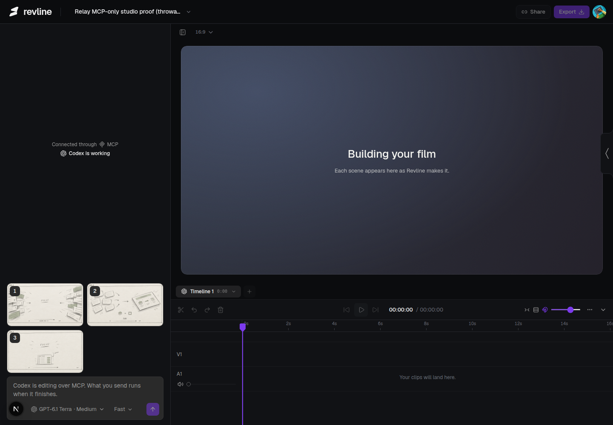
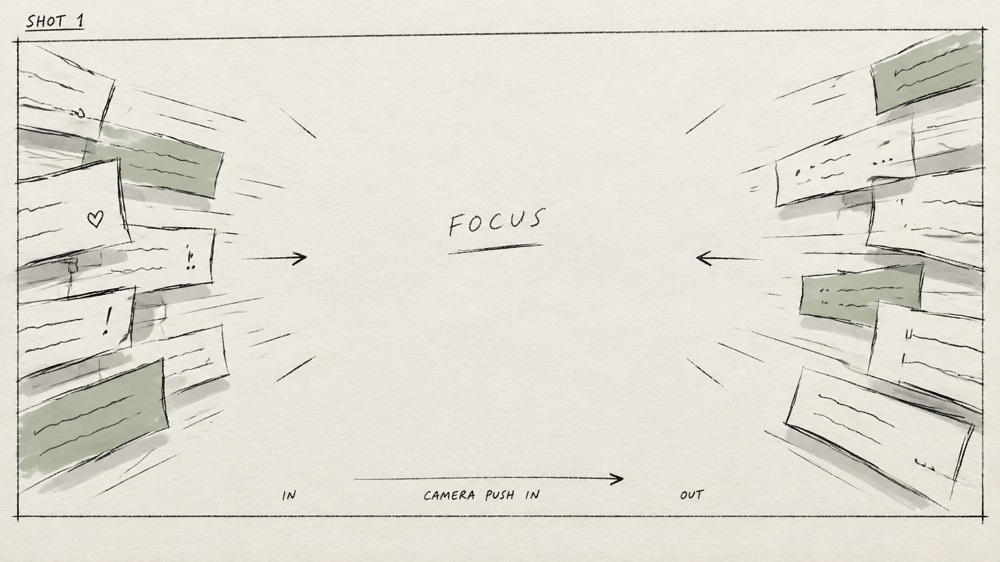
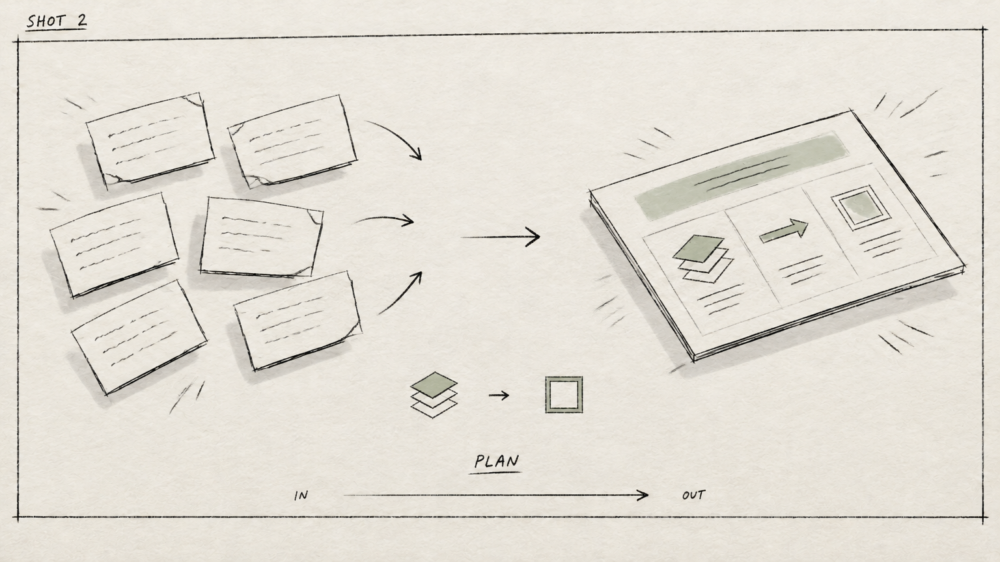
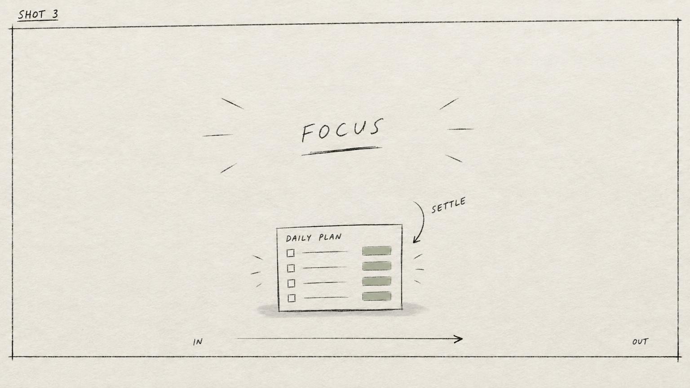

# Relay storyboard proof through Revline tools

Completed 2026-11-02 on dev majestic-alpaca-541. Reused throwaway project j978fbjj5j761aq3eydm13ez0d8hge58. Every workflow action below was an actual `npx convex run mcpActions:callTool` call with `--deployment dev`, using the same registered toolkit as the in-app Cloudflare runner and MCP. The client catalogue did not need a refresh.

Text concepts were saved before the first image. Frame order was first, last, then middle; both later frames referenced frame 1. All three previews were inspected and their stored assets were read with readFrames before presentStoryboard published them. Approval notes explicitly identify the authorized proof operator.

Result: saved rough board, 3 reference images, 0 timeline clips. Three GPT Image 2.5 Flare low-quality calls cost an estimated $0.036611. The saved plan holds idea, visual, on-screen text, plain motion notes, transition and asset needs for each shot.



| # | Tool | Result |
| --- | --- | --- |
| 1 | `readSkill` | storyboard |
| 2 | `readSkill` | image-direction |
| 3 | `readSkill` | motion-design/taste |
| 4 | `saveStoryboard` | Saved concept stage |
| 5 | `generateImage` | Frame 1; j57a97br0cv0ssax5wdf44jm758hgrnp; $0.00503 |
| 6 | `generateImage` | Frame 3; j57bja6ztpd5495ah2fqpy8yhn8hgq8w; $0.015688 |
| 7 | `generateImage` | Frame 2; j575bdqevfnm37v24tkczty8td8hgtkj; $0.015893 |
| 8 | `readFrames` | Read still j57a97br0cv0ssax5wdf44jm758hgrnp at 1536 × 864 |
| 9 | `readFrames` | Read still j575bdqevfnm37v24tkczty8td8hgtkj at 1536 × 864 |
| 10 | `readFrames` | Read still j57bja6ztpd5495ah2fqpy8yhn8hgq8w at 1536 × 864 |
| 11 | `presentStoryboard` | Published frames 1–3 |
| 12 | `saveStoryboard` | Saved rough stage |
| 13 | `getProject` | Saved rough board and three reference assets exposed |
| 14 | `inspectTimeline` | Saved rough board and three reference assets exposed |

## Exact calls

Each JSON object is the complete argument supplied to mcpActions:callTool.

### 1. readSkill

```json
{
  "ownerId": "user_3J6haPbqAxyt46ENoaruOoAXZN1",
  "agentName": "Codex",
  "name": "readSkill",
  "arguments": {
    "projectId": "j978fbjj5j761aq3eydm13ez0d8hge58",
    "name": "storyboard"
  }
}
```

### 2. readSkill

```json
{
  "ownerId": "user_3J6haPbqAxyt46ENoaruOoAXZN1",
  "agentName": "Codex",
  "name": "readSkill",
  "arguments": {
    "projectId": "j978fbjj5j761aq3eydm13ez0d8hge58",
    "name": "image-direction"
  }
}
```

### 3. readSkill

```json
{
  "ownerId": "user_3J6haPbqAxyt46ENoaruOoAXZN1",
  "agentName": "Codex",
  "name": "readSkill",
  "arguments": {
    "projectId": "j978fbjj5j761aq3eydm13ez0d8hge58",
    "name": "motion-design",
    "page": "taste"
  }
}
```

### 4. saveStoryboard

```json
{
  "ownerId": "user_3J6haPbqAxyt46ENoaruOoAXZN1",
  "agentName": "Codex",
  "name": "saveStoryboard",
  "arguments": {
    "projectId": "j978fbjj5j761aq3eydm13ez0d8hge58",
    "name": "Relay - Clear the space",
    "stage": "concept",
    "context": "Authorized fictional Relay proof for busy small teams: silent 12-second 16:9 launch film. Relay turns scattered team messages into a daily focus plan. Use abstract paper diagrams, never invented product UI. CTA: Make room for focus.",
    "promise": "Turn message noise into one clear working day.",
    "aspectRatio": "landscape",
    "concepts": [
      {
        "name": "Clear the space",
        "idea": "A crowded field of message scraps becomes one open, workable day.",
        "beats": [
          "A clear space promises a focused day, then scattered message scraps crowd in.",
          "Relay gathers the scraps into one simple daily plan.",
          "Three diagram moments show fewer loose messages, clearer next steps and room to focus.",
          "Make room for focus holds in the cleared space as a thumbnail."
        ],
        "look": "Quiet paper-and-ink hint, generous space.",
        "motion": "Scraps gather and align, leaving the frame open.",
        "why": "Busy small teams see the change from noise to clarity at a glance."
      },
      {
        "name": "Follow the thread",
        "idea": "Follow one task along a route from a tangled handoff to a clear next step.",
        "beats": [
          "One mark promises a smoother handoff.",
          "Branches form a tangled route through scattered messages.",
          "Relay draws the branches together into a clear daily plan.",
          "Three stops show fewer loose messages, clearer next steps and room to focus.",
          "The route ends at Make room for focus, held as the thumbnail."
        ],
        "look": "A simple route-diagram hint.",
        "motion": "One mark travels through the story and carries us between shots.",
        "why": "A concrete journey makes the product easy to explain."
      }
    ],
    "chosenConcept": 1,
    "approved": true,
    "approvalNote": "Authorized throwaway proof selection: concept A, Clear the space. The user requested the Relay storyboard flow end to end."
  }
}
```

### 5. generateImage

```json
{
  "ownerId": "user_3J6haPbqAxyt46ENoaruOoAXZN1",
  "agentName": "Codex",
  "name": "generateImage",
  "arguments": {
    "projectId": "j978fbjj5j761aq3eydm13ez0d8hge58",
    "purpose": "storyboard",
    "quality": "low",
    "aspectRatio": "16:9",
    "count": 1,
    "transparentBackground": false,
    "prompt": "One rough hand-drawn storyboard panel in the architectural concept-sketch discipline. Pencil and black fineliner on off-white paper, loose construction lines, light grey marker shading, visible paper tooth. Palette only off-white, graphite, light grey and ONE muted sage-green marker accent for the key element. Flat daylight on paper, no photographic depth. Wide 16:9 composition with a visible uneven hand-drawn panel border and the shot number in a corner. Show motion with hand-drawn arrows, a few speed lines, a camera-move arrow and tiny IN/OUT notes. Minimal handwritten labels; keep full planned copy as blank title space, not finished typography. Same paper, pen pressure and drawing hand as frame 1 when referenced. This is an intentionally unfinished thumbnail for a buildable SVG/GSAP/paper-layer film. Never polished, never 3D-rendered, never glowing. No neon, glass panels, purple/lime/blue gradients, floating app UI cards, lens flares, bokeh, sparkles, holograms, people, stock photography, mountains or invented product screens. SHOT 1. A generous clear central space is squeezed by scattered paper message scraps entering from both edges. Planned motion: The headline fades up, then message scraps slide inward and crowd the space. Leave central title space largely blank, at most the short rough label FOCUS.",
    "storyboard": {
      "name": "Relay - Clear the space",
      "phase": "rough",
      "shotIndex": 1,
      "idea": "A clear working day is crowded by message noise",
      "visual": "A generous clear central space is squeezed by scattered paper message scraps entering from both edges.",
      "onScreenText": "Make room for focus",
      "motion": "The headline fades up, then message scraps slide inward and crowd the space",
      "transition": "The scraps gather toward the center and become the plan",
      "assetsNeeded": [
        "Paper grain texture",
        "Separate hand-drawn paper scraps",
        "Editable headline"
      ],
      "duration": 4
    }
  }
}
```

### 6. generateImage

```json
{
  "ownerId": "user_3J6haPbqAxyt46ENoaruOoAXZN1",
  "agentName": "Codex",
  "name": "generateImage",
  "arguments": {
    "projectId": "j978fbjj5j761aq3eydm13ez0d8hge58",
    "purpose": "storyboard",
    "quality": "low",
    "aspectRatio": "16:9",
    "count": 1,
    "transparentBackground": false,
    "referenceAssetIds": [
      "j57a97br0cv0ssax5wdf44jm758hgrnp"
    ],
    "prompt": "One rough hand-drawn storyboard panel in the architectural concept-sketch discipline. Pencil and black fineliner on off-white paper, loose construction lines, light grey marker shading, visible paper tooth. Palette only off-white, graphite, light grey and ONE muted sage-green marker accent for the key element. Flat daylight on paper, no photographic depth. Wide 16:9 composition with a visible uneven hand-drawn panel border and the shot number in a corner. Show motion with hand-drawn arrows, a few speed lines, a camera-move arrow and tiny IN/OUT notes. Minimal handwritten labels; keep full planned copy as blank title space, not finished typography. Same paper, pen pressure and drawing hand as frame 1 when referenced. This is an intentionally unfinished thumbnail for a buildable SVG/GSAP/paper-layer film. Never polished, never 3D-rendered, never glowing. No neon, glass panels, purple/lime/blue gradients, floating app UI cards, lens flares, bokeh, sparkles, holograms, people, stock photography, mountains or invented product screens. SHOT 3. One small outlined daily plan low in frame, centered open space for the CTA and ample paper margins. Planned motion: The CTA draws in and the small plan settles below it. Show ONLY the ending composition, not the crowded scraps from the reference. Use the reference to preserve the exact paper, pen, loose hand and sage accent. Border and corner shot number 3; short rough FOCUS label in generous central title space, a settle arrow near the small plan, and OUT at the edge.",
    "storyboard": {
      "name": "Relay - Clear the space",
      "phase": "rough",
      "shotIndex": 3,
      "idea": "Hold a clear CTA that also works as a thumbnail",
      "visual": "One small outlined daily plan low in frame, centered open space for the CTA and ample paper margins.",
      "onScreenText": "Make room for focus",
      "motion": "The CTA draws in and the small plan settles below it",
      "transition": "Hold the final composition cleanly to the end",
      "assetsNeeded": [
        "Editable CTA type",
        "Paper grain texture",
        "Stroke-drawn plan"
      ],
      "duration": 4
    }
  }
}
```

### 7. generateImage

```json
{
  "ownerId": "user_3J6haPbqAxyt46ENoaruOoAXZN1",
  "agentName": "Codex",
  "name": "generateImage",
  "arguments": {
    "projectId": "j978fbjj5j761aq3eydm13ez0d8hge58",
    "purpose": "storyboard",
    "quality": "low",
    "aspectRatio": "16:9",
    "count": 1,
    "transparentBackground": false,
    "referenceAssetIds": [
      "j57a97br0cv0ssax5wdf44jm758hgrnp"
    ],
    "prompt": "One rough hand-drawn storyboard panel in the architectural concept-sketch discipline. Pencil and black fineliner on off-white paper, loose construction lines, light grey marker shading, visible paper tooth. Palette only off-white, graphite, light grey and ONE muted sage-green marker accent for the key element. Flat daylight on paper, no photographic depth. Wide 16:9 composition with a visible uneven hand-drawn panel border and the shot number in a corner. Show motion with hand-drawn arrows, a few speed lines, a camera-move arrow and tiny IN/OUT notes. Minimal handwritten labels; keep full planned copy as blank title space, not finished typography. Same paper, pen pressure and drawing hand as frame 1 when referenced. This is an intentionally unfinished thumbnail for a buildable SVG/GSAP/paper-layer film. Never polished, never 3D-rendered, never glowing. No neon, glass panels, purple/lime/blue gradients, floating app UI cards, lens flares, bokeh, sparkles, holograms, people, stock photography, mountains or invented product screens. SHOT 2. Loose message scraps on the left align into one isometric paper plan on the right, with three small diagram marks for less noise, a clear next step and open space. Planned motion: Loose scraps gather, align, then three benefit diagrams draw on in order. Use a left-to-right composition with six loose blank paper scraps becoming one orderly isometric paper plan, plus three tiny simple diagram symbols: a shortened stack, a forward arrow, and an open square. This is a physical paper diagram, not an app interface. Use the reference ONLY for paper, pen, hand and restrained sage accent. Border, corner shot number 2, short rough PLAN label only, gathering arrows and IN/OUT.",
    "storyboard": {
      "name": "Relay - Clear the space",
      "phase": "rough",
      "shotIndex": 2,
      "idea": "Relay gathers the noise into a clear plan with three benefits",
      "visual": "Loose message scraps on the left align into one isometric paper plan on the right, with three small diagram marks for less noise, a clear next step and open space.",
      "onScreenText": "Less noise. Clear next steps. Room to focus.",
      "motion": "Loose scraps gather, align, then three benefit diagrams draw on in order",
      "transition": "The plan shrinks below the final headline as the frame clears",
      "assetsNeeded": [
        "Paper grain texture",
        "Stroke-drawn SVG diagram",
        "Editable benefit labels"
      ],
      "duration": 4
    }
  }
}
```

### 8. readFrames

```json
{
  "ownerId": "user_3J6haPbqAxyt46ENoaruOoAXZN1",
  "agentName": "Codex",
  "name": "readFrames",
  "arguments": {
    "projectId": "j978fbjj5j761aq3eydm13ez0d8hge58",
    "assetId": "j57a97br0cv0ssax5wdf44jm758hgrnp",
    "start": 0,
    "end": 0,
    "count": 1
  }
}
```

### 9. readFrames

```json
{
  "ownerId": "user_3J6haPbqAxyt46ENoaruOoAXZN1",
  "agentName": "Codex",
  "name": "readFrames",
  "arguments": {
    "projectId": "j978fbjj5j761aq3eydm13ez0d8hge58",
    "assetId": "j575bdqevfnm37v24tkczty8td8hgtkj",
    "start": 0,
    "end": 0,
    "count": 1
  }
}
```

### 10. readFrames

```json
{
  "ownerId": "user_3J6haPbqAxyt46ENoaruOoAXZN1",
  "agentName": "Codex",
  "name": "readFrames",
  "arguments": {
    "projectId": "j978fbjj5j761aq3eydm13ez0d8hge58",
    "assetId": "j57bja6ztpd5495ah2fqpy8yhn8hgq8w",
    "start": 0,
    "end": 0,
    "count": 1
  }
}
```

### 11. presentStoryboard

```json
{
  "ownerId": "user_3J6haPbqAxyt46ENoaruOoAXZN1",
  "agentName": "Codex",
  "name": "presentStoryboard",
  "arguments": {
    "projectId": "j978fbjj5j761aq3eydm13ez0d8hge58",
    "assetIds": [
      "j57a97br0cv0ssax5wdf44jm758hgrnp",
      "j575bdqevfnm37v24tkczty8td8hgtkj",
      "j57bja6ztpd5495ah2fqpy8yhn8hgq8w"
    ],
    "reviewNote": "Inspected all three returned previews and read their saved media with readFrames: consistent off-white paper, pencil/fineliner, grey shading, one sage accent, hand-drawn borders and motion arrows. No glow, glossy 3D, stock people or invented product screens."
  }
}
```

### 12. saveStoryboard

```json
{
  "ownerId": "user_3J6haPbqAxyt46ENoaruOoAXZN1",
  "agentName": "Codex",
  "name": "saveStoryboard",
  "arguments": {
    "projectId": "j978fbjj5j761aq3eydm13ez0d8hge58",
    "name": "Relay - Clear the space",
    "stage": "rough",
    "context": "Authorized fictional Relay proof for busy small teams: silent 12-second 16:9 launch film. Relay turns scattered team messages into a daily focus plan. Use abstract paper diagrams, never invented product UI. CTA: Make room for focus. Look: hand-drawn paper and ink with one sage accent, because the contrast between crowded scraps and open space makes Relay's promise visible.",
    "aspectRatio": "landscape",
    "frameAssetIds": [
      "j57a97br0cv0ssax5wdf44jm758hgrnp",
      "j575bdqevfnm37v24tkczty8td8hgtkj",
      "j57bja6ztpd5495ah2fqpy8yhn8hgq8w"
    ],
    "approved": true,
    "approvalNote": "Proof operator accepted the inspected three-frame pencil board under the user's explicit authorization to run the Relay storyboard flow end to end."
  }
}
```

### 13. getProject

```json
{
  "ownerId": "user_3J6haPbqAxyt46ENoaruOoAXZN1",
  "agentName": "Codex",
  "name": "getProject",
  "arguments": {
    "projectId": "j978fbjj5j761aq3eydm13ez0d8hge58"
  }
}
```

### 14. inspectTimeline

```json
{
  "ownerId": "user_3J6haPbqAxyt46ENoaruOoAXZN1",
  "agentName": "Codex",
  "name": "inspectTimeline",
  "arguments": {
    "projectId": "j978fbjj5j761aq3eydm13ez0d8hge58",
    "timelineId": "main"
  }
}
```

## Generated rough frames






